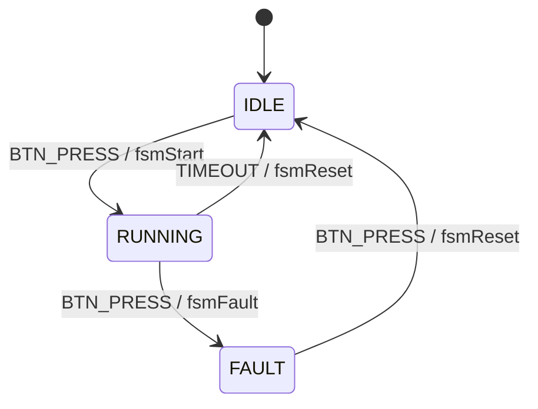

# Arquitectura del firmware: banda transportadora

## Diagrama de la FSM

## Matriz de transiciones (estado x evento)

| Estado \ Evento | NONE | BTN_PRESS | TIMEOUT |
|---|---|---|---|
| IDLE | fsmStay | fsmStart | fsmStay |
| RUNNING | fsmStay | fsmFault (frena) | fsmReset (inercia) |
| FAULT | fsmStay | fsmReset | fsmStay |

## Flujo de ejecución

1. El microinterruptor (IO33) dispara la ISR por flanco de bajada.
2. La ISR filtra rebotes con `XTHAL_GET_CCOUNT()` (4,000,000 ciclos = 25 ms a 160 MHz).
3. La ISR activa la bandera protegida por spinlock y da el semáforo binario.
4. La tarea `fsmTask` despierta, lee la bandera y despacha el evento por la matriz.
5. El handler actúa sobre el motor mediante `hal_motor`.

## Módulos

- `src/main.cpp`: ISR, semáforo, tarea FSM.
- `src/fsm_control.cpp`: estados, eventos, matriz y handlers.
- `src/hal_motor.cpp`: control del puente H (avance, frenado, inercia).